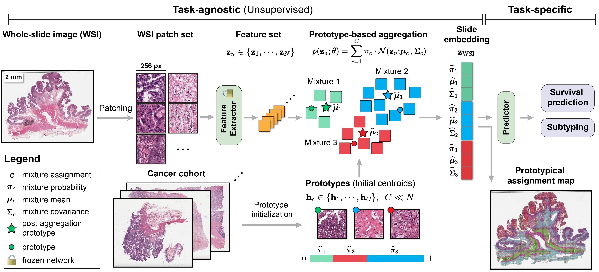

# MIST

**Molecularly Informed Spatial Transcriptomics Transform for Multiple Instance Learning in Computational Pathology**

---

## Overview

MIST is a plug-and-play module that injects spatial transcriptomics (ST) knowledge into the MIL pipeline at the patch embedding stage. A set of learnable **molecular prototypes** — initialized from ST-derived tissue microenvironment clusters — act as virtual molecular stains, conditioning each patch embedding on its molecular affinity. At inference time, **no gene expression data is required**.



### Key idea

Pathologists routinely apply IHC stains (Ki-67, CD8, PD-L1, …) after H&E to reveal molecular context. MIST simulates this: K molecular prototypes (learned from ST data) each represent a distinct tissue microenvironment. During forward pass, each patch is softly assigned to these prototypes and transformed accordingly — effectively applying K virtual molecular stains to the morphological features.

### Position in the literature

| Method | ST data at inference | Position in pipeline |
|--------|---------------------|---------------------|
| MCAT, SurvPath | Required (bulk RNA) | Fusion layer |
| PathoSpatial | Required (ST) | Fusion layer |
| SEAL (ICLR 2026) | Not required | Step 1 — patch encoder |
| MAMMOTH (ICLR 2026) | Not required | Step 2 — no molecular prior |
| **MIST (ours)** | **Not required** | **Step 2 — molecular prior** |

MIST is orthogonal to SEAL (encoder-level) and MAMMOTH (MoE aggregation) and can be combined with both.

---

## Method

MIST inserts a `MolecularStainingTransform` between the frozen patch encoder and any MIL aggregator:

```
Patch Features  (B, N, D_in)
      ↓  shared_proj
 x_low  (B, N, D)  +  Prototypes  (K, D)
      ↓  sigmoid affinity → normalize
 Affinity  (B, N, K)
      ↓  low-rank per-prototype transform  U_k @ V
 Staining views  (B, N, K, D)
      ↓  affinity-weighted sum + skip connection
 x_out  (B, N, D)
```

- **Affinity** uses sigmoid (not softmax) — a patch can activate multiple molecular stains simultaneously
- **Low-rank transform** `U_k(V(x))` with rank=16 keeps per-prototype parameters efficient (~340K total)
- **Skip connection** preserves the original morphological signal

### Molecular prototype construction (offline, one-time)

Prototypes are derived from [HEST-1k](https://github.com/mahmoodlab/HEST) (NeurIPS 2024 Spotlight — 1,229 ST+WSI paired samples, 26 organs):

1. Filter genes expressed in <10% of spots; filter empty spots
2. Total count normalization (target_sum=1e4) + log1p
3. Select top 2,000 HVGs (Seurat V3)
4. Local smoothing (Visium 6-neighbor mean)
5. K-means clustering (K=16) on 942,389 human spots
6. Prototype = mean patch embedding of each cluster

Saved outputs: `prototypes.npy` (16, 1536), `gene_expression_centroids.npy` (16, 2000).

Clustering validation: K=16 achieves the highest silhouette score (0.274). ARI vs. visual clustering = 0.162 — molecular clusters carry information not captured by morphology alone.

---

## Installation

```bash
conda env create -f env.yaml
conda activate mist
```

Requirements: Python 3.9, PyTorch 2.3.1, CUDA 12.1. Key packages: `faiss-gpu`, `scikit-survival`, `h5py`, `nystrom_attention`, `einops`.

---

## Usage

### Data preparation

**Patch features** must be pre-extracted (e.g. via [CLAM](https://github.com/mahmoodlab/CLAM) or [TRIDENT](https://github.com/mahmoodlab/Trident)) and organized as:
```
<dataroot>/extracted_mag20x_patch256_fp/<extractor>/feats_h5/
```

**Split CSVs** go in `src/splits/<task>/` with `train.csv`, `val.csv`, `test.csv` (must contain `slide_id` column).

### Training

All commands are run from `src/` using Python's `-m` flag:

```bash
cd src

# Survival prediction (Cox loss)
CUDA_VISIBLE_DEVICES=0 python -m training.main_survival \
  --data_source /path/to/feats_h5 \
  --split_dir TCGA_BRCA_overall_survival_k=0 \
  --split_names train,val,test \
  --model_type ABMIL_MIST \
  --model_config ABMIL_MIST_default \
  --in_dim 1536 \
  --loss_fn cox \
  --proto_path /path/to/prototypes.npy \
  --max_epochs 20 --lr 0.0001 --seed 1

# Classification
CUDA_VISIBLE_DEVICES=0 python -m training.main_classification \
  --data_source /path/to/feats_h5 \
  --split_dir brca_subtyping \
  --split_names train,val,test \
  --task brca_subtyping \
  --model_type ABMIL_MIST \
  --model_config ABMIL_MIST_default \
  --in_dim 1536 \
  --proto_path /path/to/prototypes.npy \
  --max_epochs 20 --lr 0.0001 --seed 1
```

`--proto_path` points to `prototypes.npy`. If omitted, prototypes are randomly initialized.

Convenience shell scripts are in `src/scripts/classification/` and `src/scripts/survival/`.

### Supported models

| `--model_type` | `--model_config` | Description |
|----------------|-----------------|-------------|
| `ABMIL` | `ABMIL_default` | Attention-based MIL (baseline) |
| `ABMIL_MIST` | `ABMIL_MIST_default` | ABMIL + MIST |
| `TransMIL` | `TransMIL_default` | Transformer MIL (baseline) |
| `TransMIL_MIST` | `TransMIL_MIST_default` | TransMIL + MIST |
| `ILRA` | `ILRA_default` | ILRA (baseline) |
| `ILRA_MIST` | `ILRA_MIST_default` | ILRA + MIST |

---

## Interpretability

`staining_affinity` (B, N, K) is returned in the model output dict and can be used to:

1. **Spatial affinity maps** — visualize which patches activate each virtual molecular stain
2. **Stain contribution analysis** — identify which molecular prototype drives the final prediction
3. **Molecular signatures** — each prototype's gene expression centroid enables pathway enrichment (GO/KEGG)

---

## Experiments

**Datasets:** TCGA-BRCA (classification + survival), TCGA-LUAD, TCGA-LUSC

**Comparison groups:**
1. Baseline (ABMIL / TransMIL / ILRA)
2. + MIST (ST initialization) ← proposed
3. + MIST (random initialization) — ablation
4. + MAMMOTH
5. + MAMMOTH + MIST

**Splits:** 5-fold cross-validation, patient-level split.

---

## Acknowledgements

This codebase builds on [PANTHER](https://github.com/mahmoodlab/PANTHER) (Song et al., CVPR 2024). Molecular prototypes are derived from [HEST-1k](https://github.com/mahmoodlab/HEST) (Jaume et al., NeurIPS 2024).

```bibtex
@inproceedings{song2024morphological,
    title={Morphological Prototyping for Unsupervised Slide Representation Learning in Computational Pathology},
    author={Song, Andrew H and Chen, Richard J and Ding, Tong and Williamson, Drew FK and Jaume, Guillaume and Mahmood, Faisal},
    booktitle={CVPR},
    year={2024},
}

@article{jaume2024hest,
    title={HEST-1k: A Dataset for Spatial Transcriptomics and Histology Image Analysis},
    author={Jaume, Guillaume and others},
    booktitle={NeurIPS},
    year={2024},
}
```
