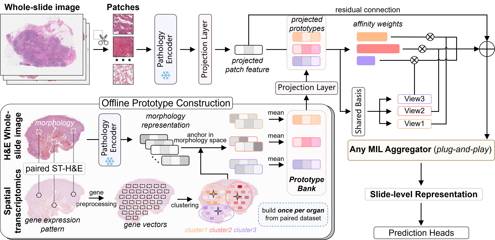

# MIST

**Bridging the Modality Bottleneck in Pathology MIL through Molecularly Guided Feature Adaptation**, NeurIPS 2026.
<br><em>Yucheng Xing, Pei Liu, Jingying Ma, Ruping Hong, Jiangdong Qiu, Tianyu Liu, Kai He, Ling Huang, Mengling Feng</em></br>

[Paper](https://arxiv.org/abs/2605.16392) · [Cite](#citation) · [Reproduce](#reproduce) · [Visualization](#visualization)

MIST (Molecularly Informed Spatial-Transcriptomic Transform) is a plug-and-play module that brings spatial transcriptomics (ST) priors into whole slide image (WSI) classification and survival prediction. Learnable molecular prototypes, initialized from ST-defined tissue microenvironments, act as virtual molecular stains: each patch is assigned to multiple prototypes and transformed through affinity-weighted, low-rank projections before MIL aggregation. A residual connection preserves morphological information. At inference, MIST operates on image features alone; no gene expression data is required.



*Figure 2. Overview of MIST, from the [paper](https://arxiv.org/html/2605.16392v2).*

## Installation

```shell
git clone https://github.com/YuchengXing99/MIST.git
cd MIST
conda env create -f env.yaml
conda activate mist
pip install nystrom-attention tensorboard matplotlib
```

The exported environment targets **Linux, Python 3.9, PyTorch 2.3.1 and CUDA 12.1**. The additional packages above are imported by the model factory, trainer and visualization tools but are not included in `env.yaml`.

For ST prototype construction, also install:

```shell
pip install scanpy scikit-misc
```

## Reproduce

The pipeline below turns paired ST data and pre-extracted WSI features into downstream predictions. Run prototype construction from the repository root and training from `src/`.

**0. Patch features (external).** Tile each WSI and extract patch embeddings with [CLAM](https://github.com/mahmoodlab/CLAM) / [TRIDENT](https://github.com/mahmoodlab/TRIDENT). Store one `<slide_id>.h5` per slide with a `features` dataset of shape `(N, D)`; include `coords` of shape `(N, 2)` for spatial visualization.

```text
<dataroot>/extracted_mag20x_patch256_fp/<extractor>/feats_h5/<slide_id>.h5
```

Pass the `feats_h5` directory to `--data_source`, without a trailing slash. The path must contain `extracted_mag<MAG>x_patch<SIZE>_fp`, which the training entry points use to recover patching metadata. Set `--in_dim` to the feature dimension; the examples below use **1536** and an illustrative extractor directory named `extracted-uni2`.

**1. Construct molecular prototypes** (K = 16) from paired ST expression and image embeddings, for example from [HEST-1k](https://github.com/mahmoodlab/HEST):

```shell
python analyze_molecular_visual_pairs.py \
    --paired-h5ad-dir /path/to/paired_h5ad \
    --out-dir /path/to/molecular_prototypes \
    --selected-k 16 --k-list 4,8,16,32,64 \
    --seed 42
```

Each paired `.h5ad` file must provide expression counts, aligned image embeddings and spatial coordinates. The script filters genes and spots, applies total-count normalization and `log1p`, selects 2,000 highly variable genes, smooths expression within each sample and clusters the molecular profiles. Mean image embeddings within each cluster initialize the molecular prototypes.

Outputs include `prototypes.npy` of shape `(K, D)` and `gene_expression_centroids.npy` of shape `(K, G)`, plus clustering diagnostics and prototypes for each requested K in `prototypes_by_k/`. Prototype embeddings must use the same encoder and feature dimension as the downstream WSI features. Paired ST inputs and generated prototypes are supplied separately.

**2. Train + evaluate survival prediction** with ABMIL + MIST:

```shell
cd src

CUDA_VISIBLE_DEVICES=0 python -m training.main_survival \
    --data_source /path/to/extracted_mag20x_patch256_fp/extracted-uni2/feats_h5 \
    --split_dir survival/TCGA_BRCA_overall_survival_k=0 \
    --split_names train,test \
    --task TCGA_BRCA --target_col os_survival_days \
    --model_type ABMIL --model_config ABMIL_MIST_default \
    --in_dim 1536 --n_proto 16 \
    --proto_path /path/to/molecular_prototypes/prototypes.npy \
    --loss_fn cox --max_epochs 20 --lr 0.0001 --seed 1 \
    --results_dir results/survival/TCGA_BRCA
```

Replace the example feature path with your own. Survival splits are in `src/splits/survival/`: BRCA provides `train.csv` and `test.csv`; LUAD, LUSC and COAD include cohort-specific test CSVs. Repeat for `k=0..4` and set `--split_names` to the available filenames without `.csv`. The example uses **overall survival** (`os_survival_days`, `os_censorship`); other endpoints can be selected with `--target_col` and the matching censorship column.

Per-fold checkpoints, configuration and metrics are written to `results/survival/TCGA_BRCA/abmil_mist/seed_1/fold_<k>/`. The survival entry point also aggregates completed folds into `all_folds.csv` and `summary.csv` in the seed directory.

**3. Train + evaluate biomarker classification**, for example ER status in TCGA-BRCA (also from `src/`):

```shell
CUDA_VISIBLE_DEVICES=0 python -m training.main_classification \
    --data_source /path/to/extracted_mag20x_patch256_fp/extracted-uni2/feats_h5 \
    --split_dir classification/biomarker/tcga_brca_er_k=0 \
    --split_names train,val,test \
    --task tcga_brca_er --target_col er_status \
    --model_type ABMIL --model_config ABMIL_MIST_default \
    --in_dim 1536 --n_proto 16 \
    --proto_path /path/to/molecular_prototypes/prototypes.npy \
    --max_epochs 20 --lr 0.0001 --early_stopping --seed 1 \
    --results_dir results/biomarker/tcga_brca_er/k=0
```

Classification splits contain `case_id`, `slide_id` and the task-specific label column. The biomarker suite covers 13 tasks across TCGA-Lung, TCGA-BRCA, TCGA-GBMLGG and BCNB: 5 folds for TCGA tasks and 10 for BCNB. See the [biomarker guide](src/scripts/classification/biomarker/README.md#tasks) for task keys, label columns and sweep commands. When running folds manually, change both `--split_dir` and `--results_dir` for each fold; classification results are saved under `<results_dir>/<model_name>/seed_<seed>/`.

MIST is enabled through **`--model_config`**; `--model_type` remains the base MIL model. Use the paired baseline configuration for an ablation without MIST:

| `--model_type` | Baseline `--model_config` | MIST `--model_config` |
|---|---|---|
| `ABMIL` | `ABMIL_default` | `ABMIL_MIST_default` |
| `TransMIL` | `TransMIL_default` | `TransMIL_MIST_default` |
| `ILRA` | `ILRA_default` | `ILRA_MIST_default` |
| `MeanMIL` | `MeanMIL_default` | `MeanMIL_MIST_default` |
| `MaxMIL` | `MaxMIL_default` | `MaxMIL_MIST_default` |
| `CLAM` | `CLAM_default` | `CLAM_MIST_default` |
| `TransformerMIL` | `TransformerMIL_default` | `TransformerMIL_MIST_default` |
| `DSMIL` | `DSMIL_default` | `DSMIL_MIST_default` |

Omit `--proto_path` for randomly initialized molecular prototypes. The default MIST configuration uses **K = 16** prototypes and **rank = 16**; `--n_proto` overrides K, while `mist_rank` is set in the configuration JSON. Dataset launch scripts in `src/scripts/survival/` and `src/scripts/classification/biomarker/` require local feature and prototype paths to be configured before use.

## Visualization

MIST exposes patch-level `staining_affinity` scores of shape `(B, N, K)` through `forward_no_loss()`. The visualization tools map these affinities back to patch coordinates, compare them with MIL attention, measure prototype importance and drift, and connect prototypes to gene expression signatures.

From `src/`, generate spatial affinity maps for a classification checkpoint:

```shell
python -m visualization.spatial_affinity \
    --ckpt results/biomarker/tcga_brca_er/k=0/abmil_mist/seed_1/s_checkpoint.pth \
    --h5 /path/to/slide_id.h5 \
    --mode classification --patch-size 256 \
    --out-dir results/visualization/slide_id
```

Use an early-stopping checkpoint containing both model weights and the saved configuration, as produced by the classification example above. The input H5 must contain `features` and `coords`. Outputs include per-prototype heatmaps, a combined panel and a dominant-prototype map. Additional tools are in [`src/visualization/`](src/visualization/); use `python -m visualization.<tool> --help` for options.

## Repository layout

```text
analyze_molecular_visual_pairs.py   ST preprocessing, molecular clustering and prototype export
run_mol_vis_analysis.sh            wrapper for paired ST / image analysis
src/mil_models/                   MIST module and eight MIL backbones
src/configs/                      paired baseline and MIST configurations
src/training/                     classification / survival entry points and shared trainer
src/wsi_datasets/                 slide-level feature and label loaders
src/data_factory/                 biomarker task definitions and label mappings
src/splits/                       survival and biomarker cross-validation CSVs
src/scripts/                      experiment launchers and parameter sweeps
src/visualization/                spatial affinity, importance, semantics and drift analysis
docs/                             supporting image assets
```

## Citation

```bibtex
@article{xing2026mist,
  title={Bridging the Modality Bottleneck in Pathology MIL through Molecularly Guided Feature Adaptation},
  author={Xing, Yucheng and Liu, Pei and Ma, Jingying and Hong, Ruping and Qiu, Jiangdong and Liu, Tianyu and He, Kai and Huang, Ling and Feng, Mengling},
  journal={arXiv preprint arXiv:2605.16392},
  year={2026},
  note={Accepted at NeurIPS 2026},
  url={https://arxiv.org/abs/2605.16392}
}
```

## Acknowledgements

Built on [PANTHER](https://github.com/mahmoodlab/PANTHER) (Song et al., CVPR 2024) for computational pathology infrastructure. Molecular priors are derived from [HEST-1k](https://github.com/mahmoodlab/HEST) (Jaume et al., NeurIPS 2024). We thank the TCGA, CPTAC, NLST and BCNB data contributors.

See [LICENSE.md](LICENSE.md) for the repository license.
